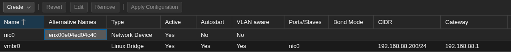
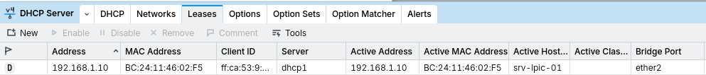
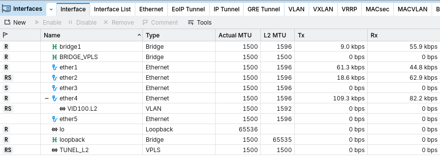

Laboratório MPLS e VPLS com MikroTik, Proxmox e Linux

1. Sobre o projeto

Este projeto tem como objetivo implementar e validar uma comunicação Layer 2 (Camada 2) entre dois roteadores MikroTik, utilizando MPLS e VPLS.

A topologia foi construída utilizando:

-Um MikroTik físico com RouterOS 6.49.20.

-Um MikroTik virtual com RouterOS 7.16, hospedado no Proxmox VE.

-OSPF como protocolo de roteamento dinâmico.

-LDP para distribuição de labels MPLS.

-MPLS para encaminhamento de pacotes identificados por labels.

-VPLS para estabelecer um pseudowire Ethernet entre os roteadores.

-Bridges Linux no Proxmox para interligação das máquinas virtuais.

-VLAN 100 para conectar o computador físico ao domínio Layer 2 do VPLS.

-Uma máquina virtual Linux para realizar os testes de conectividade.

O objetivo final é permitir que um computador físico e uma máquina virtual Linux, conectados a equipamentos diferentes, consigam se comunicar como se estivessem conectados ao mesmo segmento Ethernet.

2. Arquitetura da solução

2.1. Topologia lógica

                 COMPUTADOR FÍSICO
                    Linux Debian
                         |
                   Interface física
                         |
                     VLAN 100
                  10.10.100.2/24
                         |
                         |
                  ether4 - VLAN 100
                  MIKROTIK FÍSICO
                  RouterOS 6.49.20
                  Router-ID: 10.255.0.2
                         |
                  bridge-vpls-teste
                         |
                     vpls-teste
                         |
                ===== MPLS / LDP =====
                         |
                  REDE DE TRANSPORTE
                    192.168.88.0/24
                         |
                  Proxmox vmbr0
                         |
                  ether1 - MikroTik
                  MIKROTIK VIRTUAL
                  RouterOS 7.16
                  Router-ID: 10.255.0.1
                         |
                     vpls-teste
                         |
                    bridge-vpls
                         |
                 Interface dedicada
                         |
                       vmbr2
                         |
                   VM Linux 100
                  10.10.100.1/24

2.2. Inventário de endereçamento

Equipamento: MikroTik físico

Interface: bridge1

Endereço: 192.168.88.1/24

Finalidade: Transporte

------------------------------------

Equipamento: MikroTik virtual

Interface: ether1

Endereço: 192.168.88.250/24

Finalidade: Transporte

------------------------------------

Equipamento: MikroTik físico

Interface: Loopback

Endereço: 10.255.0.2/32

Finalidade: Router-ID / LDP

------------------------------------

Equipamento: MikroTik virtual

Interface: Loopback

Endereço: 10.255.0.1/32

Finalidade: Router-ID / LDP

------------------------------------

Equipamento: MikroTik físico

Interface: ether4

Endereço: 192.168.5.1/24

Finalidade: Acesso/gerenciamento

------------------------------------

Equipamento: PC Linux

Interface: VLAN 100

Endereço: 10.10.100.2/24

Finalidade: Teste VPLS

------------------------------------

Equipamento: VM Linux

Interface: ens19

Endereço: 10.10.100.1/24

Finalidade: Teste VPLS

Observação: os endereços de transporte e loopback acima correspondem à topologia utilizada no laboratório. Os endereços de acesso devem ser conferidos nas configurações finais antes de publicar a documentação.

3. Preparação do ambiente Proxmox

Antes de configurar os protocolos de rede, foi necessário preparar a infraestrutura virtual para permitir a comunicação entre os roteadores e as máquinas virtuais.

Foram utilizadas três bridges Linux no Proxmox: vmbr0, vmbr1 e vmbr2.

3.1. vmbr0 — Rede de transporte

A vmbr0 é responsável pela comunicação entre o MikroTik virtual e o MikroTik físico.

Ela está associada à interface física de rede do servidor Proxmox, identificada como nic0.

Configuração lógica:

Parâmetro
--------------
Nome: vmbr0

Tipo: Linux Bridge

Bridge port: nic0

Endereço Proxmox: 192.168.88.200/24

Gateway: 192.168.88.1

A interface ether1 do MikroTik virtual foi conectada à vmbr0.

Essa rede transporta o tráfego de controle e os pacotes MPLS entre os roteadores.

vmbr0:
 

Mikrotik virtual:

 

3.2. vmbr1 — Rede interna das máquinas virtuais

A vmbr1 foi utilizada como bridge interna para conectar as máquinas virtuais à rede do Mikrotik virtual e receber o DHCP configurado.

O MikroTik virtual possui uma interface conectada a essa bridge, responsável pela rede DHCP das VMs.

Essa rede foi mantida separada do circuito VPLS para evitar misturar o tráfego original das máquinas virtuais com o tráfego do laboratório MPLS.

vmbr1:
 

Interface da VM:

 

Mikrotik Virtual:

 

MAC da VM:

 

3.3. vmbr2 — Rede dedicada ao VPLS

Foi criada uma terceira bridge, chamada vmbr2, para disponibilizar um segmento Ethernet isolado exclusivamente para os testes do VPLS.

Diferentemente da vmbr0, essa bridge não possui interface física associada.

Parâmetro
-------------
Nome: vmbr2

Tipo: Linux Bridge

Bridge ports: Nenhum

IPv4/CIDR: Sem endereço

Gateway: nenhum

Autostart: Habilitado

A vmbr2 funciona como um switch virtual isolado.

Foram adicionadas interfaces de rede conectadas a essa bridge:

-Uma interface na VM do MikroTik virtual.

-Uma interface na VM Linux de testes.

Isso permitiu conectar a máquina Linux diretamente à bridge VPLS do MikroTik virtual, sem interferir na rede DHCP existente.

vmbr2:
 

VM:

 

Mikrotik Virtual:

 

3.4. Interfaces de rede das máquinas virtuais

VM do MikroTik

A VM do MikroTik ficou com três interfaces de rede:

net0 - vmbr0 - transporte MPLS

net1 - vmbr1 - Rede original/DHCP

net2 - vmbr2 - Acesso ao domínio VPLS

Atenção: o nome atribuído pelo RouterOS à interface Ethernet pode variar. Na evidência final do laboratório, a interface aparece como ether4.

VM Linux

Foi adicionada uma segunda interface de rede à VM Linux de testes, conectada à vmbr2.

A interface original foi preservada para não perder a conectividade existente.

 4. Configuração do MikroTik físico

4.1. Identificação das interfaces

O primeiro passo foi identificar as interfaces disponíveis no MikroTik físico e entender quais estavam sendo utilizadas.

A configuração existente utilizava a bridge1 como parte da rede de transporte.

As interfaces ether2 e ether3 estavam associadas à bridge1.

A ether4 foi preservada para acesso e gerenciamento, sendo posteriormente utilizada para receber a VLAN de teste.

Interfaces:

 

